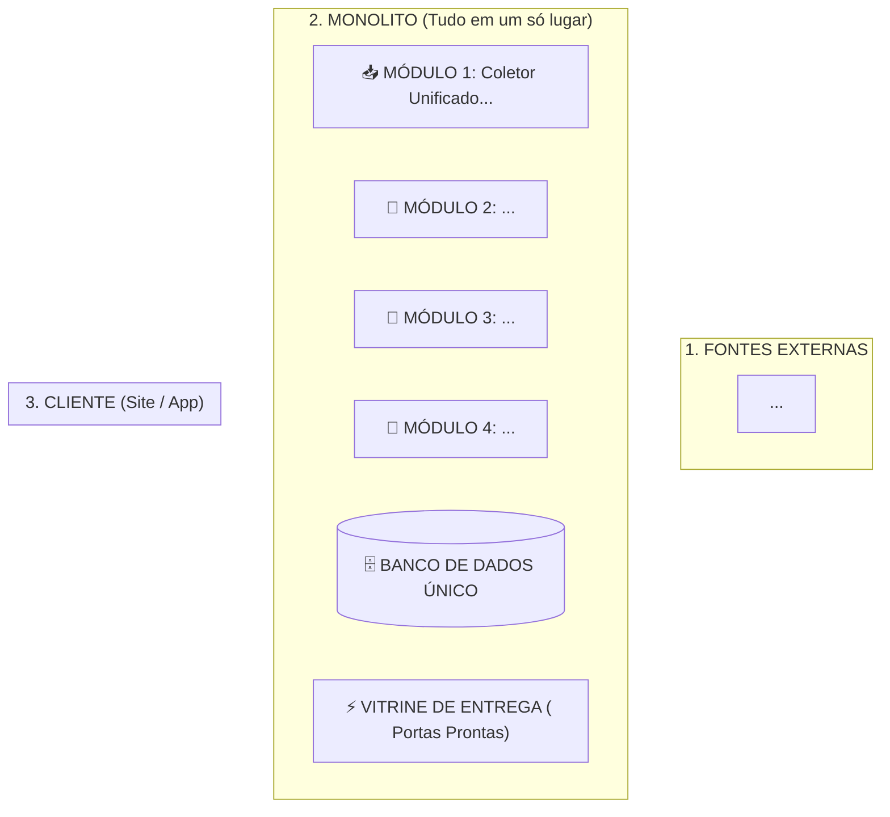

# Templates dos 3 Artefatos de Discovery

Use estes moldes para estruturar `README.md`, `ARQUITETURA.md` e `AGENTS.md` com simetria 1:1.

---

## 1. `README.md` (Pedido de Produto & Experiência do Usuário)

O `README.md` apresenta o produto sem jargão de código, focado 100% no valor entregue ao usuário final e podado pela **Navalha de Occam**.

```markdown
# <Nome do Produto> — Pedido de Produto (<Temporada/Escopo>)

## 1. Visão Geral e Identidade da Marca
- **Nome do Produto e Domínio:** ...
- **Identidade Visual / Posicionamento:** ...
- **Formato:** (ex.: Site Mobile-First e Aplicativo)
- **Objetivo Único do Produto:** ...

Toda informação exibida responde a uma única pergunta do usuário: **"<Pergunta-Guia Única>"**

---

## 2. Estrutura do Produto (Os <N> Pilares)

### Pilar 1 — <Nome da Visão/Tela 1>
1. **<Bloco Acionável 1>:** ...
2. **<Bloco Acionável 2>:** ...

### Pilar 2 — <Nome da Visão/Tela 2> (pode conter momentos A e B, ex.: Pré e Pós)
...

### Pilar 3 — <Nome da Visão/Tela 3>
...

---

## 3. Experiência do Usuário (Mobile-First & Navegação)
- **Decisão Rápida:** ...
- **Navegação Integrada:** ...
- **Linguagem Direta:** ...

---

## 4. Documentação Complementar
- **[Arquitetura em Alto Nível — Como Buscamos, Organizamos e Entregamos os Dados (Monolito + Navalha de Occam)](./ARQUITETURA.md)**
```

### Checklist Occam para o `README.md`
- **Sem metadados decorativos:** Se um dado não altera a decisão do usuário e exige scraping frágil, remova.
- **Matéria-prima $\neq$ Produto final:** Em vez de exibir feeds brutos para o usuário ler e interpretar, entregue o impacto já processado (ex.: *Radar de Impacto* em vez de *Portal de Notícias*).
- **Indicadores determinísticos:** Troque conceitos subjetivos ("disputa aberta") por métricas calculáveis ("Titular em 4/5 jogos") e use **um único selo visual** para o mesmo conceito em todas as telas.

---

## 2. `ARQUITETURA.md` (Navalha de Occam + Deep Modules)

O `ARQUITETURA.md` explica como o sistema funciona de ponta a ponta em linguagem clara, mapeando **Fontes + Planos B**, **Módulos Profundos** e **Portas Prontas de Entrega**.

```markdown
# <Nome do Produto> — Como Buscamos, Organizamos e Entregamos os Dados (Arquitetura em Alto Nível)

## 1. Filosofia do Projeto: Navalha de Occam + Módulos Profundos

### A. Navalha de Occam (Cortar tudo o que é desnecessário)
> *"Diante de duas formas de resolver o mesmo problema, a mais simples — que exige menos peças e menos suposições — deve ser a escolhida."*

- **Um Único Monolito e Banco Único:** ...
- **Zero Retrabalho para o Cliente/Celular:** O sistema já deixa as **<K> portas prontas** para leitura imediata.

### B. Módulos Profundos (*Deep Modules* — `codebase-design`)
```
┌───────────────────────────────────────────┐
│   PORTA DE ENTRADA SIMPLES (Interface)    │  ← 1 pedido simples
├───────────────────────────────────────────┤
│      TRABALHO PESADO ESCONDIDO            │  ← Busca, limpeza, cálculos, IA e Plano B
│           (Implementação)                 │    ficam escondidos aqui dentro.
└───────────────────────────────────────────┘
```
- **Profundidade (*Depth*):** Muito trabalho inteligente atrás de uma Interface pequena.
- **Localidade (*Locality*):** Cada regra de negócio tem um único módulo dono (*Single Source of Truth*).
- **Costuras Reais (*Seams & Adapters*):** Tomadas trocáveis apenas onde há dependência externa real, com Plano B embutido no próprio Adapter.

---

## 2. Diagrama Geral: Das Fontes até a Tela do Usuário



---

## 3. Como Vamos Conseguir Cada Dado (Mapa das Fontes e Planos B)

| O que precisamos saber | De onde vem o dado | Qual é o Plano B (Navalha de Occam) |
|---|---|---|
| ... | ... | ... |

---

## 4. Os <M> Módulos do Monolito (O que cada funcionalidade faz)

### Funcionalidade 1 — Coletor Unificado do Mundo Externo
- **Qual é a função:** Único ponto que fala com APIs externas, resolve identidades (`id_interno` ↔ `id_externo`) e grava snapshots datados sem sobrescrever histórico consolidado.

### Funcionalidade 2..M — <Nome do Módulo Profundo>
- **Qual é a função:** Explicitar de quais cálculos este módulo é a **Fonte Única da Verdade (*Single Source of Truth*)**, quais filtros aplica na base e quais artefatos congela.
- **O que ela entrega:** ...

---

## 5. Como os Dados Ficam Organizados e Como o Cliente Consome (<K> Portas de Entrega)

(Diagrama ASCII ligando o Banco Único às <K> Portas Prontas + Resumo 1:1 de cada Porta com os Pilares do README.md)
```

---

## 3. `AGENTS.md` (Guia Operacional Escrito com `writing-for-agents`)

O `AGENTS.md` fica sempre carregado no contexto do agente. Deve ser enxuto, denso, positivo e usar **Context Pointers** para evitar *sprawl*.

```markdown
# AGENTS.md — <Nome do Projeto>

Guia operacional para agentes no repositório **<Nome do Projeto>**.

## Context Pointers (leia sob demanda)

- **Escopo de produto, telas (<Pilares>) ou UX:** leia [`README.md`](./README.md).
- **Fontes de dados, módulos do Monolito, planos B (fallbacks) ou portas de entrega:** leia [`ARQUITETURA.md`](./ARQUITETURA.md).
- **Referência histórica/homologação (se houver):** consulte `<caminho>` somente para pesquisa.

## Propósito

Entregar um **Monolito** que <resumo em 1 frase das responsabilidades e das K portas prontas>, com um único objetivo: **<objetivo único do produto>**.

## Princípios de Design (`codebase-design` + Navalha de Occam)

- **Navalha de Occam:** Prefira um único processo, um único banco de dados e pacotes prontos de leitura. Resolva com a estrutura que exige menos peças móveis.
- **Deep Modules (Módulos Profundos):** Concentre o trabalho pesado atrás de uma **Interface** pequena por módulo:
  1. **<Módulo 1>:** <responsabilidade única>.
  2. **<Módulo 2>:** <responsabilidade única>.
  ...
- **Seams & Adapters reais:** Crie uma **Seam** apenas onde houver variação externa real. Mantenha o fallback dentro do próprio **Adapter**.
- **Locality & Leverage:** Cada regra de negócio vive em um único módulo (**Single Source of Truth**). Testes cruzam a mesma **Interface** pública que os chamadores usam.
- **Injeção explícita e retorno puro:** Passe dependências pela **Interface** e retorne dados estruturados determinísticos.

## Invariantes de Domínio (Gotchas Críticos)

- **<Invariante 1 (ex.: Ordem de Precedência)>:** ...
- **<Invariante 2 (ex.: Proteção de Snapshots / Imutabilidade)>:** ...
- **<Invariante 3 (ex.: Regras de Exclusão / Limiares Exatos)>:** ...

## Critérios de Conclusão (Completion Criteria)

Antes de encerrar qualquer tarefa neste repositório:
1. **Testes verdes:** Todos os testes da **Interface** do módulo alterado passam sem depender de rede externa (use fixtures/fakes na **Seam**).
2. **Sem segredos no código:** Chaves e URLs sensíveis são lidas exclusivamente de variáveis de ambiente (`.env` listado no `.gitignore`).
3. **Documentação sincronizada:** Qualquer mudança nas portas de entrega, nos módulos ou nas fontes de dados está refletida em [`ARQUITETURA.md`](./ARQUITETURA.md) e, se alterar a experiência do usuário, em [`README.md`](./README.md).
```
